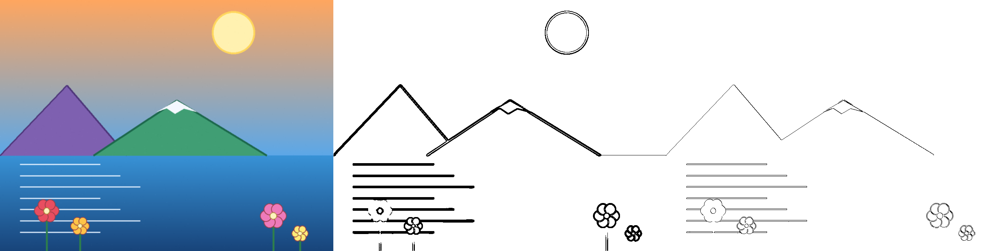
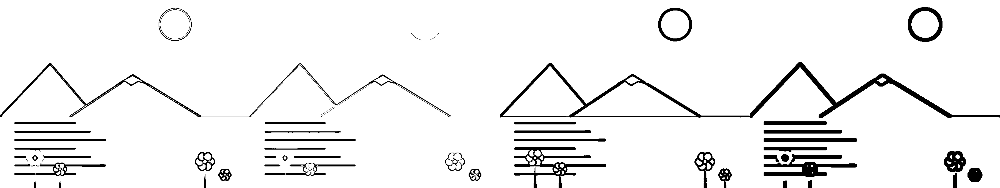

# 图转线稿 · TuZhuanXianGao

**把彩色图片一键变成线描图的 Android App。** 导入即出稿，输出**纯白底 + 纯黑线**、无灰噪点，可直接作为**纹身转印打印机底稿**使用；自带原图/线稿对比、镜像转印、色卡提取。

> **v1.1.0 更新**：新增「浓度」与「线条粗细」两个独立调节项（原有「灵敏度」保留），三项改完都会自动重新生成；默认值与 v1.0 完全一致，升级不影响既有出稿效果。

- 完全离线：不申请 `INTERNET` 权限，图片不上传任何服务器
- 零依赖：不用 Gradle、Android Studio、AndroidX、OpenCV、ONNX 模型或任何第三方库
- 兼容 Android 7.0（API 24）及以上，targetSdk 34
- APK 体积通常 < 200 KB



> 上图由 `tools/run_coretest.sh` 在桌面端直接跑同一套 Java 算法生成，从左到右为：原图、智能线稿、经典勾线。

---

## 一、傻瓜式操作

| 步骤 | 操作 | 结果 |
| --- | --- | --- |
| 1 | 点 **「＋ 选择图片」**（或在相册里把图片「分享」到本应用） | 自动导入、自动出线稿，无需任何设置 |
| 2 | 左右**拖动分割线**看前后对比 | 也可以用「并排对比」或「按住看原图」 |
| 3 | 需要转印时打开 **「镜像转印」** | 图案水平翻转，转印到皮肤上才是正的 |
| 4 | 点 **「保存底稿」** | 无损 PNG 存入相册 `Pictures/图转线稿`，或直接「分享」给打印机 App |

### 三个调节项（改完自动重新生成，不用点确认）

| 调节项 | 范围 | 作用 | 建议 |
| --- | --- | --- | --- |
| **灵敏度** | 0–100 | 边缘检出的敏感程度，越高越容易抓到弱边缘 | 照片 50–70，线条画 40–50 |
| **浓度** | 0–100 | 线条墨量：越高越多弱边缘被画成黑线，画面更密实 | 转印底稿 40–60；想更清爽就调低 |
| **粗细** | 1–5 档 | 逐档做 3x3 形态学膨胀加粗线条（每档约 +2px） | 小幅转印图建议 2–3 档 |

三者互不重复：**灵敏度**决定"能不能检出边缘"，**浓度**决定"检出的边缘画多少"，**粗细**决定"画出来的线有多宽"。无论怎么调，白底保护始终生效，输出仍是 100% 纯二值。



> 四栏自测数据：默认黑线 4.29%、浓度 15% → 2.92%、浓度 85% → 6.75%、粗细 4× → 9.47%，四档其它像素均为 0.00%（二值纯度 100%）。

其它功能（同样即时生效）：

- **智能线稿 / 经典勾线**：两种算法，前者适合照片和插画，后者是 `color-card` 的原始勾线思路
- **纯黑白**：关闭后输出带轻微灰阶的柔和线条；默认开启，底色绝对干净
- **提取色卡**：融合 `color-card` 的 `crowd` / `naive`，从原图取主色，点色块复制 HEX 色值

---

## 二、复刻与融合的两个开源项目

| 参考项目 | 原实现方式 | 本项目的融合方式 |
| --- | --- | --- |
| [luckycucu/image-to-line-drawing](https://github.com/luckycucu/image-to-line-drawing) | Python + 两个 ONNX 模型：`line-drawings.onnx` 提取线稿，`line-relifer.onnx` 做增强（去噪、修正线条、更像笔画） | 复刻其「**先提取、再增强**」两级流水线，但用等价的传统 CV 实现：DoG + 色差边缘 → 自适应二值化 → 孤立点/小连通域去噪 → 断线连接 → 毛刺修正。达到同样的「去噪 + 线条更像笔画」效果，**无需下载模型、纯离线、可在手机上秒级完成** |
| [userElaina/color-card](https://github.com/userElaina/color-card) | C++ + ffmpeg 转 BMP；`line(pth, dis, onlyline, color)` 用相邻像素 RGB 距离勾线（`dis` 越大线越少、`onlyline` 只留线稿、`color` 调色）；`linear()` 做颜色线性变换；`crowd()` / `naive()` 提取色卡 | 完整复刻 `line()` 作为「经典勾线」模式（含 `dis` 阈值与 `onlyline` 白底）；用 `linear()` 的思路做**自动色阶拉伸**，这是「底色干净」的关键一步；把 `crowd()`（颜色量化分桶按占比取主色）和 `naive()`（网格分区取色）做成 App 内的「提取色卡」功能 |

> 说明：本项目**没有复制**上述项目的源代码，全部算法为独立编写，仅借鉴其公开的设计思路与算法原理。参考项目 `image-to-line-drawing` 采用 Apache-2.0（不含示例图片）；`color-card` 的许可以其仓库声明为准。本项目自身采用 MIT，见 [LICENSE](LICENSE)。

### 与参考项目相比，为「纹身转印」做的针对性优化

1. **纯二值输出**：输出像素只有 `0xFF000000`（黑线）和 `0xFFFFFFFF`（白底）两种值。默认参数自测：黑线 4.29% / 纯白底 95.71% / 其它 **0.00%**，二值纯度 **100%**，没有灰底、没有网点噪点，热敏转印机识别稳定。
2. **自动色阶 + 白底保护**：先按 0.5% / 99.5% 分位做线性拉伸，二值化时再加 `lineGray < 250` 的硬条件，大片底色强制纯白；浓度偏移只作用于"是否成线"的判定，不改动这个白底条件。
3. **连通域去噪**：删掉面积小于 `总像素/40000` 的零散黑点，避免转印后出现脏点。
4. **一键镜像**：纹身转印必须打印镜像稿，App 里就是一个开关。
5. **无损 PNG 导出**：不经过 JPEG 压缩，线条边缘不糊。

---

## 三、算法流水线（`LineArtCore.java`，纯 Java，无 Android 依赖）

1. **灰度化**：Rec.601 亮度
2. **`linear()` 自动色阶**：直方图 0.5%/99.5% 分位 → 线性映射 `[lo,hi] → [0,255]`
3. **降噪**：可分离 box blur（三次近似高斯）
4. **线强度**（`sensitivity` 控制增益）：
   - 智能模式 = DoG（高斯差分）+ Sobel 梯度 + `color-card` 相邻像素 RGB 曼哈顿距离 三路加权融合，并对强色差边界加保底强度（避免浅色主体、同灰度异色轮廓丢失）
   - 经典模式 = `color-card line()`：`max(右邻色距, 下邻色距) > dis` 判定为轮廓
5. **自适应二值化**：Bradley 局部均值阈值（积分图 O(n)）+ **浓度偏移**（`density` 平移线稿灰度，控制多少弱边缘成线）+ 白底保护（基于**原始**灰度判定，浓度再高底色也不脏）
6. **线条增强**（对应 `line-relifer`）：去孤立点 → 8 连通域面积过滤 → **粗细**（`lineWidth` 1~5 档，逐档 3x3 膨胀）→ 填孔连接断笔 → 二次清理
7. **输出**：纯黑白 / 柔和灰阶、可选反色、可选水平镜像、可选替换底色（`color` 参数）

`ColorCard.java` 另实现 `crowd()`（RGB 各量化 3 bit 共 512 桶，按占比排序）与 `naive()`（网格分区平均色）。

---

## 四、构建 APK

### 环境要求

- JDK 11+（脚本用 `javac --release 11`）
- Android SDK：`platforms;android-34` + `build-tools;34.0.0`

```bash
sdkmanager "platforms;android-34" "build-tools;34.0.0"
export ANDROID_HOME=/opt/android-sdk      # 或你的 SDK 路径，也可用 ANDROID_SDK_ROOT
./build.sh
```

产物：`app/TuZhuanXianGao-v1.1.0.apk`（可用 `./build.sh /自定义/路径.apk` 指定）。

`build.sh` 用的是 Android SDK 官方命令行工具的标准链路，不拉取任何 Maven 依赖：

```
aapt2 compile → aapt2 link(生成 R.java + base.apk, -0 arsc)
→ javac → jar → d8(classes.dex) → zip 合并 → zipalign → keytool 自签名 → apksigner 签名并校验
```

首次构建会在 `build/` 下自动生成自签名密钥（**`build/` 已被 git 忽略，不会入库**）。

### 安装

```bash
adb install -r app/TuZhuanXianGao-v1.1.0.apk
```

或把 APK 传到手机上直接点开安装（需允许「安装未知来源应用」）。

### 桌面端算法自测（不需要 Android SDK）

```bash
./tools/run_coretest.sh
```

会生成 `tools/sample.png`、`docs/preview.png`、`docs/line_*.png`，以及新增的 `docs/controls_preview.png`（浓度/粗细四栏对比）和 `docs/ctrl_*.png`，并在终端打印每种模式与每个参数档位的黑白像素占比（可核对二值纯度是否 100%）及色卡结果。

---

## 五、目录结构

```
.
├── AndroidManifest.xml
├── build.sh                      # 一键构建 APK
├── app/                          # 构建产物 APK
├── docs/
│   ├── sample.png                # 测试原图
│   ├── preview.png               # 原图/智能/经典 三栏对比预览
│   ├── controls_preview.png      # 浓度与粗细四栏调节预览
│   ├── line_*.png                # 各模式输出
│   └── ctrl_*.png                # 各参数档位输出
├── res/
│   ├── mipmap-*/ic_launcher.png  # 5 种密度图标
│   └── values/strings.xml
├── src/com/inkline/lineart/
│   ├── LineArtCore.java          # 核心算法（纯 Java，可桌面自测）
│   ├── LineArtEngine.java        # Android Bitmap 适配层
│   ├── ColorCard.java            # crowd / naive 色卡
│   ├── CompareView.java          # 滑动 / 并排对比视图
│   ├── ArtProvider.java          # 只读分享 ContentProvider
│   └── MainActivity.java         # 界面与交互
└── tools/
    ├── make_assets.py            # 生成图标与测试图
    ├── CoreTest.java             # 桌面端算法自测
    └── run_coretest.sh
```

---

## 六、权限与隐私

| 权限 | 用途 |
| --- | --- |
| `WRITE_EXTERNAL_STORAGE`（仅 `maxSdkVersion=28`） | Android 9 及以下把 PNG 写进公共相册 |
| 无其它权限 | 导入图片走系统文件选择器（SAF），**不需要读取存储权限**；**不申请联网权限**，所有计算在本机完成 |

分享文件通过应用内只读 `ContentProvider` 暴露 `content://` URI，避免 Android 7.0+ 的 `FileUriExposedException`。

---

## 七、纹身转印使用提示

- 打开「镜像转印」再保存，按 **1:1 原始尺寸**打印，不要缩放填充
- 建议先在普通纸上打小样确认线条；复杂照片可调高「灵敏度」或「浓度」，线条太细转印不清就把「粗细」调到 2~3 档，也可切到「经典勾线」
- 本工具是辅助描图工具，不替代专业纹身师的手工调整；用于皮肤前请自行确认图案与卫生规范

---

## 八、致谢与许可

算法思路来自 [luckycucu/image-to-line-drawing](https://github.com/luckycucu/image-to-line-drawing) 与 [userElaina/color-card](https://github.com/userElaina/color-card)，感谢作者的开源分享。

本项目代码采用 **MIT License**，详见 [LICENSE](LICENSE)。
